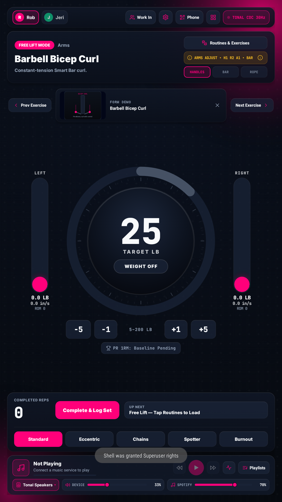
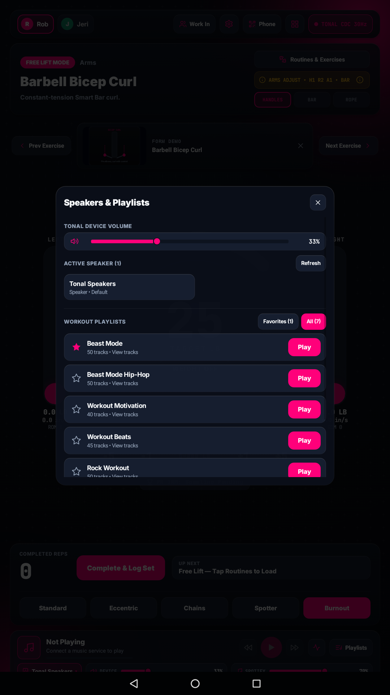
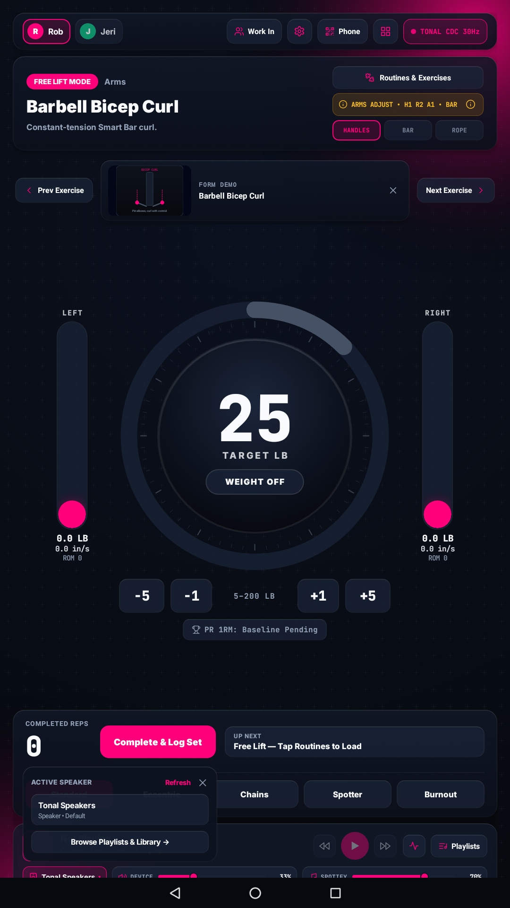

# swonal-ui

**Open-Source Workout Controller, Hardware Motor Bridge, Pluggable Music Hub, & AI Companion for Rooted Tonal V1**

[](https://opensource.org/licenses/MIT)
[](https://nodejs.org/)
[](https://www.python.org/)
[](https://developer.android.com)

`swonal-ui` frees and modernizes the rooted **Tonal 1 (V1)** digital-weight home gym. It replaces proprietary cloud lock-in with a completely open, self-hosted, offline-first ecosystem featuring:

- **Native 60fps Android Kiosk**: Silky hardware-accelerated Canvas views on the 1080x1920 portrait wall display, with zero garbage-collection pauses.
- **Bi-Directional 30Hz Motor Bridge**: Real-time strain-gauge load sensing, automatic rep counting, velocity-based training (VBT), and arm orientation telemetry.
- **Fail-Safe Fast Path**: Instant `<5ms` emergency motor disengage (`WEIGHT OFF`) directly over local loopback, safeguarding lifters even during network loss.
- **Pluggable Music Hub**: Integrated **Spotify Connect** ("Tonal Speakers"), **Plexamp**, **YouTube Music**, **Apple Music**, and **Amazon Music** with automatic volume ducking during cues.
- **Mobile Companion Web App (`/companion`)**: Remote control, routine builder, and live metrics from any smartphone on your local network.
- **Bring-Your-Own-Key AI Voice Coach**: Real-time form tips and workout programming powered by OpenAI, Anthropic, Gemini, Ollama, or Model Context Protocol (MCP) agents.
- **Home Assistant Integration**: Real-time MQTT discovery and webhook event bus for smart home automations.

---

## Visual Tour

*All screenshots captured live on physical Tonal V1 hardware running `swonal-ui`.*

| **Live Workout Stage** | **Speakers & Workout Playlists** |
|:---:|:---:|
|  |  |
| *Real-time 30Hz load dial, symmetrical cable travel pucks, VBT velocity meter, rep counter, quick weight steppers, and active music dock with hardware volume.* | *Integrated speaker selection ("Tonal Speakers"), device volume slider (33%), favorites-first workout playlists, and one-tap playback.* |

| **Active Speaker Selection** | **Arm Alignment & Sensor Sync** |
|:---:|:---:|
|  |  |
| *Quick-switch output between built-in Tonal stereo speakers and external Spotify Connect endpoints with live status.* | *Live hardware readout of arm height, rotation, and angle sensors (`0x1020`/`0x1021`/`0x1025`) matching target exercise configuration.* |

| **Form Demo & Biomechanics** | **Exercise Catalog & Custom Routines** |
|:---:|:---:|
|  |  |
| *Picture-in-Picture (PiP) animated SVG/video form loop demonstrating proper lifting technique and primary muscle targets.* | *50+ built-in movements, custom exercise creation, saved multi-movement routines, and one-tap workout loading.* |

---

## Getting Started

### Prerequisites

1. **Rooted Tonal V1 Tablet**: Running Android 6.0 Marshmallow with Magisk v27+ installed and active.
   - *If your device is not yet rooted, follow the step-by-step guide in [RUNBOOK-Tonal V1 Rooting & On-Device Setup Guide.md](file:///home/brombomb/dev/swonal-ui/RUNBOOK-Tonal%20V1%20Rooting%20&%20On-Device%20Setup%20Guide.md) using `mtkclient`.*
2. **Wi-Fi Connection**: Both your host server/laptop and the Tonal tablet connected to the same local network.
3. **Host Tools**: `git`, `docker` (or Node.js 22+ & Python 3.11+), and Android platform-tools (`adb`).

---

### Step 1: Deploy `server-app` (Your Home Server)

Run `server-app` on any local server, Raspberry Pi, NAS, or desktop on your network (e.g. `192.168.1.100` or a local domain):

#### Option A: Docker Compose (Recommended)

```bash
git clone https://github.com/swonal/swonal-ui.git
cd swonal-ui

# Create configuration
cp .env.example .env
# Optional: customize PORT, Spotify, AI Coach, or Home Assistant keys

# Launch container with persistent SQLite database
docker compose up -d --build server-app
```

#### Option B: Bare-Metal Node.js

```bash
cd packages/server-app
npm install
cp ../../.env.example .env
npx prisma db push
npx tsx prisma/seed.ts
npm run build
npm start
```

Verify that the dashboard opens cleanly at `http://<SERVER_IP>:3000`.

---

### Step 2: Automated On-Device Installation (One Command)

The automated script [`scripts/install-device.sh`](file:///home/brombomb/dev/swonal-ui/scripts/install-device.sh) handles the entire tablet deployment over Wi-Fi ADB:

1. **Connect to the Tonal tablet over Wi-Fi**:
   ```bash
   adb connect <TONAL_IP>:5555
   adb shell "su -c id"
   # Verify output: uid=0(root) gid=0(root)
   ```

2. **Build the Native Kiosk APK**:
   ```bash
   cd packages/android-kiosk
   ./gradlew :app:assembleDebug
   cd ../..
   ```

3. **Run the Installer**:
   ```bash
   ./scripts/install-device.sh \
     --target <TONAL_IP>:5555 \
     --server-url http://<SERVER_IP>:3000 \
     --allow-debug
   ```

#### What the Automated Installer Configures:
- **Native Kiosk App**: Deploys `com.swonal.kiosk` pre-configured to your server.
- **Persistent Wireless ADB**: Configures `/data/adb/service.d/00-swonal-adbd.sh` to extract the Wi-Fi IP and keep port `5555` alive across all reboots.
- **Hardware Serial Protection**: Restricts `/dev/ttyACM0` strictly to `0600 root:root` and stops stock Tonal MCB services from locking the motor controller.
- **Magisk Root Pre-Grant**: Automatically pre-grants permanent superuser rights (`policy=2`, `notification=0`) to eliminate notification toasts.
- **On-Device Audio**: Deploys the static `librespot` daemon configured as **"Tonal Speakers"** with kernel multicast routing for instant Spotify Connect discovery.
- **Hardware Motor Bridge**: Deploys `tonal-daemon` into Termux and sets up background auto-start services on device boot.

---

### Step 3: Launch & Everyday Use

Once installed, Swonal Kiosk automatically boots on the Tonal wall display:

- **Switching to Stock Tonal & Back**: Tap the quick-action menu at the top right of the screen and choose **"Exit to Stock Tonal"**. The daemon releases `/dev/ttyACM0` and launches stock software with a discreet floating overlay pill. Tapping the pill returns instantly to Swonal Kiosk without rebooting.
- **Mobile Remote Control**: Open `http://<SERVER_IP>:3000/companion` on your smartphone (or scan the on-screen QR code) to queue exercises, adjust weight, and monitor reps from across the room.
- **Local Fail-Safe Protection**: If Wi-Fi ever drops mid-set, tapping **WEIGHT OFF** bypasses the network entirely via local loopback socket (`127.0.0.1:8765`), dropping cable tension in `<5ms`.
- **Dedicated Application Settings**: Navigate to `/settings` or tap the gear icon to configure Lifters, Music Providers, BYOK AI Coach, Network overrides, and Security/Data backups.

---

## Local Development (Without Hardware)

You can run and test the complete ecosystem on any macOS, Linux, or Windows (WSL2) laptop:

```bash
# 1. Start the 30Hz Mock Hardware Simulator
cd packages/tonal-daemon
python3 -m venv .venv && source .venv/bin/activate
pip install -e .
pytest -v
python3 -m src.main --mock

# 2. In another terminal, start the Server App
cd packages/server-app
npm install
npx prisma db push && npx tsx prisma/seed.ts
npm test
npm run dev

# 3. In another terminal, verify End-to-End communication
node scripts/verify-e2e.mjs
```

---

## Community & Contributing

Contributions are warmly welcomed! Please ensure all test suites pass before submitting pull requests:

```bash
npm --prefix packages/server-app test
packages/tonal-daemon/.venv/bin/pytest packages/tonal-daemon/tests/test_daemon.py
(cd packages/android-kiosk && ./gradlew :app:testDebugUnitTest)
```

## License

This project is licensed under the [MIT License](LICENSE).  
*Tonal is a registered trademark of Tonal Systems, Inc. This independent open-source project is not affiliated with, sponsored by, or endorsed by Tonal Systems, Inc.*
