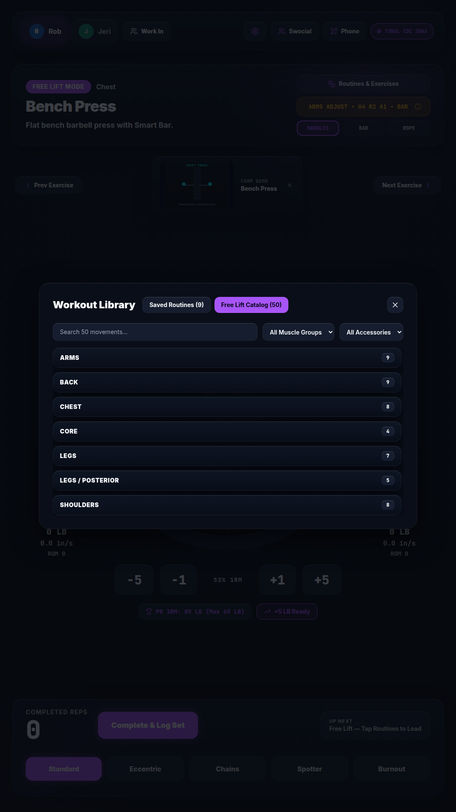
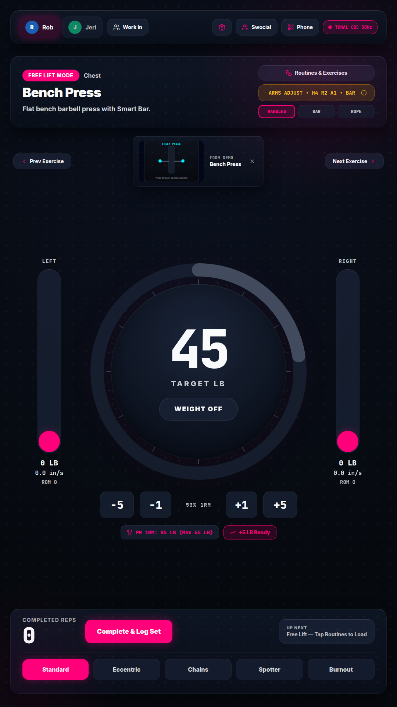
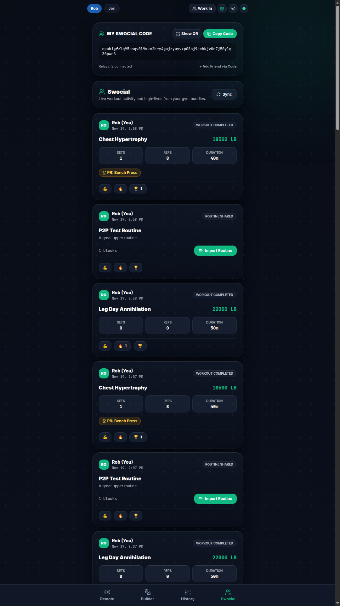

# swonal-ui

**Open-Source Workout Controller, Hardware Motor Bridge, Decentralized P2P Social Feed, & AI Addons for Rooted Tonal V1**

[](https://opensource.org/licenses/MIT)
[](https://nodejs.org/)
[](https://www.python.org/)
[](https://developer.android.com)
[](https://github.com/brombomb/swonal-ui/releases)

`swonal-ui` frees and modernizes the rooted **Tonal 1 (V1)** digital-weight home gym. It replaces proprietary cloud lock-in with a completely open, self-hosted, offline-first ecosystem featuring:

- **Native 60fps Android Kiosk**: Hardware-accelerated Canvas views rendered directly on the 1080x1920 portrait wall display, with zero garbage-collection stutter.
- **Bi-Directional 30Hz Motor Bridge**: Real-time strain-gauge load sensing, automatic rep counting, velocity-based training (VBT), and arm orientation telemetry.
- **Fail-Safe Fast Path**: Instant `<5ms` emergency motor disengage (`WEIGHT OFF`) directly over local loopback socket, safeguarding lifters even during network loss.
- **Decentralized P2P Friends (Nostr)**: Self-sovereign gym buddy network powered by Nostr (secp256k1 `npub1...`). Share workouts, exchange routine templates, and send encouragement (`💪`, `🔥`, `🏆`) peer-to-peer across home NATs without central servers or tracking.
- **Mobile Companion Web App (`/companion`)**: Remote control, routine builder, friends feed, and live metrics from any smartphone on your local network.
- **AI Addons for MCP & Voice**: Autonomous workout programming via Model Context Protocol (MCP) agents (Claude, Cursor), hands-free AirPods voice control, and real-time in-set audio coaching.
- **Local Spotify Connect Audio on Tonal Speakers**: Built-in `librespot` receiver and Android `AudioTrack` PCM bridge (`:41478`) enabling users to play their Spotify playlists directly through the Tonal wall speakers with automatic audio ducking during voice cues.
- **Home Assistant Integration**: Real-time MQTT discovery and webhook event bus for smart home automations.

---

## Visual Tour

*All screenshots captured at 1080x1920 portrait resolution on physical Tonal V1 hardware, highlighting multi-user personal accent themes.*

| **Live Workout Stage** *(Electric Lime)* | **Movement Catalog & Exercises** *(Vibrant Violet)* |
|:---:|:---:|
|  |  |
| *Real-time 30Hz load dial, symmetrical cable travel pucks, VBT velocity meter, rep counter, rest countdown, and quick weight steppers.* | *50+ built-in movements, target muscle groups, required accessories (Handles, Bar, Rope), and arm position presets.* |

| **Arm Alignment & Sensor Sync** *(Neon Cyan)* | **Form Demo & Biomechanics** *(Hot Coral)* |
|:---:|:---:|
|  |  |
| *Live arm height, rotation, and angle position indicators matching the target exercise configuration.* | *Picture-in-Picture (PiP) animated form loop demonstrating proper lifting technique and primary muscle activation.* |

| **AI Voice Coach & MCP Agent** *(Solar Amber)* | **Swocial Network & Feed** *(Emerald)* |
|:---:|:---:|
|  |  |
| *Bring-Your-Own-Key AI Voice Coach (OpenAI, Anthropic, Gemini, Ollama) and live MCP server integration for autonomous workout programming.* | *Peer-to-peer fitness network: tap "Swocial" in the header or phone companion to share your Swocial QR code, celebrate friend PRs, send reactions (`💪`, `🔥`, `🏆`), and 1-tap import routines.* |

---

## Pre-Built Releases & Distribution

Because Tonal V1 is a **single, standardized, fixed hardware platform** (MediaTek MT8173, portrait 1080x1920, Android 6.0 Marshmallow with Magisk root), pre-built binaries are distributed directly — **no Android build tools or complex toolchains required**:

### 1. Pre-Built Android Kiosk APK
Download the latest `swonal-kiosk.apk` from [GitHub Releases](https://github.com/brombomb/swonal-ui/releases) and install via Wi-Fi ADB:

```bash
adb connect <TONAL_IP>:5555
adb install -r swonal-kiosk.apk
```

### 2. Pre-Built Server Container
Run the server app instantly on your home server, NAS, or desktop using Docker:

```bash
docker run -d \
  --name swonal-server \
  --restart unless-stopped \
  -p 3000:3000 \
  -e TONAL_DAEMON_URL=http://<TONAL_IP>:8765 \
  -e TONAL_DAEMON_WS_URL=ws://<TONAL_IP>:8765/ws \
  -v swonal-data:/app/data \
  ghcr.io/brombomb/swonal-ui:latest
```

Automated builds and releases are produced continuously by the [.github/workflows/release.yml](.github/workflows/release.yml) CI/CD pipeline whenever a release tag is pushed.

---

## AI Addons for MCP & Voice (Work in Progress)

Swonal includes first-class AI extensibility designed for modern LLMs and agentic workflows:

### Model Context Protocol (MCP) Server
The built-in MCP server exposes live Tonal hardware telemetry, exercise catalogs, and lifter PRs directly to AI tools like **Claude Desktop**, **Cursor**, **Gemini CLI**, or custom Python agents:

- **Transports**:
  - HTTP Server-Sent Events (SSE): `http://<SERVER_IP>:3000/mcp/sse`
  - Local Stdio: `node packages/server-app/dist/server/mcp/stdio.js`
- **Resources**:
  - `swonal://exercises/catalog`: Complete library of movements, mechanics, and recommended arm positions.
  - `swonal://users/{userId}/profile-and-prs`: Lifter strength profiles, estimated 1RMs, and weight unit preferences.
  - `swonal://session/active`: Live in-progress workout session telemetry.
- **Tools**:
  - `create_workout_template`: Build personalized multi-block workout routines.
  - `queue_workout_for_session`: Queue an AI-programmed routine directly onto the Tonal screen.
  - `update_weight`: Set precise target digital weight and training mode.
  - `log_set`: Automatically record completed sets with RPE and volume tracking.

### Real-Time Voice Coach & Hands-Free AirPods Control (Local & BYOK)
- **Hands-Free AirPods / Bluetooth Voice Mode**: Tap the prominent **AirPods Voice** button in the Kiosk header or Companion Remote to issue continuous hands-free commands while lifting:
  - **Weight Deltas & Targets**: *"Add 5 pounds"*, *"Increase weight by ten"*, *"Drop 5 pounds"*, *"Set weight to 50 pounds"* (supports both digits and spoken number words).
  - **Weight Engage / Disengage**: *"Weight on"*, *"Engage weight"*, *"Weight off"*, *"Rack weight"*.
  - **Dynamic Training Modes**: *"Switch to chains mode"*, *"Eccentric mode"*, *"Spotter mode"*, *"Burnout mode"*, *"Standard mode"*.
  - **Workouts & Exercises**: *"Next exercise"*, *"Previous exercise"*, *"Switch to Barbell Bicep Curl"*, *"Skip rest"*, *"Complete set"*.
- **Live Audio Encouragement & VBT Coaching**: Speaks real-time coaching cues directly into your AirPods on weight engage, rep milestones (first rep, halfway, final 2 reps, target reached), PR celebrations (*"Boom! New personal record!"*), and >=25% velocity drop fatigue alerts.
- **Built-In Offline Coach + BYOK LLM Support**: Works 100% offline out-of-the-box, or connect any OpenAI, Anthropic, Google Gemini, or local Ollama model (`0600` encrypted server storage).

---

## Getting Started

### Prerequisites

1. **Rooted Tonal V1 Tablet**: Running Android 6.0 Marshmallow with Magisk v27+ installed and active.
   - *If your device is not yet rooted, follow the step-by-step guide in [RUNBOOK-Tonal V1 Rooting & On-Device Setup Guide.md](RUNBOOK-Tonal%20V1%20Rooting%20&%20On-Device%20Setup%20Guide.md) using `mtkclient`.*
2. **Wi-Fi Connection**: Both your host server/laptop and the Tonal tablet connected to the same local network.
3. **Host Tools**: `docker` (or Node.js 22+ & Python 3.11+), and Android platform-tools (`adb`).

---

### Step 1: Deploy `server-app` (Your Home Server)

Run `server-app` on any local server, Raspberry Pi, NAS, or desktop on your network (e.g. `192.168.1.100` or a local domain):

#### Option A: Docker Compose (Recommended)

```bash
git clone https://github.com/brombomb/swonal-ui.git
cd swonal-ui

# Create configuration
cp .env.example .env

# Launch container with persistent SQLite database
docker compose up -d --build server-app
```

#### Option B: Bare-Metal Node.js

```bash
cd packages/server-app
npm install
cp ../../.env.example .env
npx prisma db push
npx tsx prisma/seed.ts
npm run build
npm start
```

Verify that the dashboard opens cleanly at `http://<SERVER_IP>:3000`.

---

### Step 2: Automated On-Device Installation (One Command)

The automated script [`scripts/install-device.sh`](scripts/install-device.sh) handles the entire tablet deployment over Wi-Fi ADB:

```bash
./scripts/install-device.sh \
  --target <TONAL_IP>:5555 \
  --server-url http://<SERVER_IP>:3000 \
  --allow-debug
```

#### What the Automated Installer Configures:
- **Native Fullscreen Kiosk**: Deploys the Swonal Kiosk app with automatic server discovery, offline user and workout caching, and seamless background reconnection.
- **Embedded Browser Engine**: Prepares the display runtime for high-performance rendering, ensuring smooth UI navigation and settings access without crashes.
- **Hardware Motor Bridge**: Configures the high-speed background service that controls motor resistance and streams real-time cable telemetry.
- **Persistent Wireless ADB**: Keeps wireless access active across reboots so you can manage and update your Tonal without cables.
- **Automatic Storage Maintenance**: Cleans temporary installation files, caches, and logs automatically so your Tonal never runs low on disk space.
- **Fast Incremental Updates (`--sync`)**: Pushes only changed files in seconds when deploying updates:
  ```bash
  ./scripts/install-device.sh --target <TONAL_IP>:5555 --sync
  ```

---

### Step 3: Everyday Use

Once installed, Swonal Kiosk automatically boots on the Tonal wall display:

- **Switching Between Swonal & Stock Tonal**: Tap the menu at the top right of the screen and choose **"Exit to Stock Tonal"**. A floating button allows you to return to Swonal at any time without rebooting.
- **Phone Companion & Swocial**: Open `http://<SERVER_IP>:3000/companion` on your smartphone (or scan the on-screen QR code) to queue exercises, adjust weight, view friends' workouts, and share routines.
- **Hardware Safety**: If the network connection is ever interrupted during a set, pressing the on-screen **WEIGHT OFF** button immediately cuts cable tension locally.
- **Remote Screen View**: View and control the Tonal display remotely from your computer using:
  ```bash
  ./scripts/scrcpy.sh
  ```
- **Application Settings**: Tap the gear icon to manage lifters and their saved workout programs, customize AI voice coach settings (BYOK & MCP server), and configure network preferences.

---

## Local Development (Without Hardware)

You can run and test the complete ecosystem on any macOS, Linux, or Windows (WSL2) laptop:

```bash
# 1. Start the 30Hz Mock Hardware Simulator
cd packages/tonal-daemon
source .venv/bin/activate
pip install -e .
pytest -v
python3 -m src.main --mock

# 2. In another terminal, start the Server App
cd packages/server-app
npm install
npx prisma db push && npx tsx prisma/seed.ts
npm test
npm run dev

# 3. In another terminal, verify End-to-End communication
node scripts/verify-e2e.mjs
```

---

## Community & Contributing

Contributions are warmly welcomed! Please ensure all test suites pass before submitting pull requests:

```bash
npm --prefix packages/server-app test
packages/tonal-daemon/.venv/bin/pytest packages/tonal-daemon/tests/test_daemon.py
(cd packages/android-kiosk && ./gradlew :app:testDebugUnitTest)
```

## License

This project is licensed under the [MIT License](LICENSE).  
*Tonal is a registered trademark of Tonal Systems, Inc. This independent open-source project is not affiliated with, sponsored by, or endorsed by Tonal Systems, Inc.*
